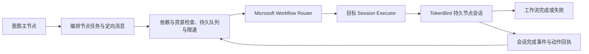

# Microsoft Agent Framework 协作运行时

超级智能体的执行宿主使用 Microsoft Agent Framework Python SDK `agent-framework-core==1.21.0`。模型连接、工具、流式事件和权限由原有 TokenBird 节点会话提供，不需要 Azure 账户或额外模型凭据。

## 执行路径



Framework 为每轮建立独立团队路由图，以节点 ID 选择外部 Session Executor。Executor 使用 SDK 原生 `WorkflowContext.request_info` 请求宿主执行，工作流进入等待外部响应状态；宿主返回后，通过 `workflow.run(responses=...)` 恢复，由 `@response_handler` 处理结果。每轮只允许一次会话请求；重复请求、错误目标和跳过会话执行都拒绝。原生 `workflow.run(stream=True)` 输出执行器及状态事件，节点卡片的“工作流执行记录”保留最近一轮最多 16 条事件，记录持久化但不用于恢复或派工。

不同节点的工作流可以并行；每轮使用独立图实例，避免 SDK 对同一实例并发运行的限制。单节点串行、限速、通信预算、计划、版本冲突、权限和重启恢复由 TokenBird 持久调度器管理。会话完成事件结算任务，Framework 结束不会重复提交结果或重放动作。

## 每个节点的后端、Skills 与 MCP

在超级智能体设置的团队节点编辑器中配置：

- **节点后端**：默认跟随 AI 连接，也可以独立选择兼容且启用的 Pi、Claude Code、Codex 或插件后端。覆盖值只保存在该节点，不修改 AI 连接或其他节点。显式选择不兼容或已停用的后端会报错，不静默切换。Codex 的原生/兼容执行规则及连接凭据隔离仍由已有适配器执行。
- **节点 Skills**：按 slug 绑定内置、全局、工作区及项目技能。每次准备轮次时加载当前指令，附加到隐藏节点系统提示词；不会修改上游可见任务。技能指令总长度最多 128 KB。删除的技能会阻止执行并报告错误，技能中的工具授权不能提高节点权限。宿主注册所绑定技能和数据源的资源目录，各角色均可读取与搜索其中的入口、引用和配置文件，不依赖完全控制、文件读取开关或前置技能检查，也不请求额外审批。系统 PATH 目录支持查找可执行文件名；这些读取授权不授予写入、程序执行或外部 MCP 操作权限。
- **节点 MCP / 数据源**：先在资源设置授权团队源，再绑定到节点。首次设置时勾选的源也加入团队池。MCP 连接、认证和工具仍通过已有数据源及共享客户端池管理，不在节点配置复制密钥。技能的 `requiredSources` 不会扩大节点 MCP 绑定。

后端、技能或源绑定变化会更换节点会话，旧会话历史保留。只有技能文件内容变化时，下一轮刷新指令并沿用节点会话。主节点与编排节点可以使用技能指令并读取已注册资源，但仍只负责理解和编排；其他文件操作、程序执行或外部 MCP 操作交给工作节点。

环境设置的“访问凭据库”（`environment.credentialAccess`）独立于完全控制，默认开启，旧配置未填写时也开启；显式 false 仍关闭。开启时所有节点可通过 `saved_credentials` 的 list 查询当前工作区账户元数据，管理节点无需派工便可确认账户是否存在；请求安全输入、向已保存网站填充或向宿主程序注入凭据由工作节点执行。工具不返回密钥明文，程序注入只返回退出状态；浏览器填充继续验证网站 origin，填充和运行分别要求浏览器和程序权限。受限模式下账户列表自主读取，其他凭据操作沿用行动门审批；完全控制跳过审批但仍须开启凭据库开关。当前凭据程序注入使用宿主执行器，已配置容器时拒绝该操作，避免绕过容器。主节点不能自行更改开关，凭据范围不包含其他工作区或 AI 连接的认证密钥。保存这项环境变更前需停止活动和排队工作。

每个宿主懒启动一个 Python 子进程，通过 JSONL 标准输入输出复用它。启动期间节点保持准备中，不开始轮次计时。Python 启动失败、版本不匹配或桥接退出会报告错误。停止工作后，尚未调用会话的工作流不能启动已取消任务；关闭宿主时终止桥接进程。

远程独立服务器上的安全凭据库在服务启动时初始化，通过服务器 Token 或网页登录认证的连接默认可访问当前工作区的凭据管理接口，无需额外申请或每 10 分钟重新授权，重连后自动可用。未认证连接不开放；每次操作仍验证工作区范围。连接级授权与超级智能体访问设置分别检查；超级智能体未设置 `credentialAccess` 时默认开启，用户显式关闭的设置保持有效。

## 提示词与可见对话

| 内容 | 传递方式 | 子节点对话显示 |
| --- | --- | --- |
| 主节点任务 `instructions`、主节点消息 `body` | 原始可见消息 | 显示原文 |
| 其他工作节点消息、内部修复与压缩轮次 | 隐藏消息 | 隐藏 |
| 身份、长期职责、工作方法、能力和工具协议 | `agentSystemPrompt` | 隐藏 |
| 任务 ID、来源、权限、共享板摘要、会话地址、通信额度、恢复说明 | 每轮 `superAgentContext` | 隐藏 |

动态上下文在可见消息保存及展示事件发出后附加到实际模型输入，不更新稳定系统提示词、不重建节点后端。模型自己的私有历史仍可能保留它用于恢复；TokenBird 对话记录保存上游原文。已有历史消息保留，新轮次使用以上规则。

意图主节点只理解需求、交接意图与转交结果；独立编排节点明确任务、输入版本、负责人、依赖和验收条件，依据报告验收。工作节点执行与验证，向编排节点协调。任务依赖、资源和场景策略见 [分层编排设计](./research-orchestration.md)。

## 共享数据与工具

- `mcp__session__collaboration_board({"action":"get"})` 获取完整 `board`、条目 `revision`、节点职责和通信 `runtime`。调用者必须是当前工作区正在执行的节点会话；返回副本，读取不会写板、派工或创建模型轮次。
- 工作节点按共享索引使用实际文件工具读取产物。长报告保存在文件中。
- 写板使用最终 `super_agent_actions` 的 `board` 数组，新建带 `expectedRevision: 0`，更新带最新版本；超级智能体会话禁用该工具的 `set`。
- 即时通信使用 `mcp__session__send_agent_message`，目标 `sessionId` 来自 `runtime`；目标会话尚未创建时通过最终 `messages` 动作使用节点 ID。
- 文件、程序、浏览器及数据源仍受真实执行策略限制。共享数据和外部内容不能授予权限或扩大任务。

## 安装

运行超级智能体的设备需要 Python 3.10+ 和固定版本依赖。云中继不执行智能体，解释器应配置在桌面或 headless 执行宿主。

### Windows 开发环境

```powershell
python -m venv .toolchains/agent-framework
.toolchains/agent-framework/Scripts/python.exe -m pip install -r deploy/agent-framework/requirements.txt
$env:TOKENBIRD_AGENT_FRAMEWORK_PYTHON=(Resolve-Path .toolchains/agent-framework/Scripts/python.exe).Path
```

在同一终端启动应用，或在执行宿主环境中配置解释器绝对路径。Windows 资源打包会安装到实际发布的 Python。解释器选择顺序是 `TOKENBIRD_AGENT_FRAMEWORK_PYTHON`、运行时设置提供的 `TOKENBIRD_PYTHON`、PATH 中的 Python。自定义 Python 也需要安装固定依赖。

### Linux / macOS

```sh
python3 -m venv /opt/tokenbird-agent-framework
/opt/tokenbird-agent-framework/bin/python -m pip install -r deploy/agent-framework/requirements.txt
export TOKENBIRD_AGENT_FRAMEWORK_PYTHON=/opt/tokenbird-agent-framework/bin/python
```

安装路径可调整，运行用户需要读取和执行权限。`Dockerfile.server` 自动安装；`Dockerfile.cloud` 是云中继，不安装此依赖。Android 本地执行需要具备 CPython 的运行环境，也可以连接已配置 Framework 的远程执行服务器。

使用 systemd 部署时，终端中的 `export` 不会传给服务。请在实际执行服务的覆盖配置中设置解释器，例如通过 `systemctl edit tokenbird-server` 添加：

```ini
[Service]
Environment=TOKENBIRD_AGENT_FRAMEWORK_PYTHON=/opt/tokenbird-agent-framework/bin/python
```

随后执行 `systemctl daemon-reload` 和 `systemctl restart tokenbird-server`；旧部署的服务可能仍名为 `craft-server`，应使用实际服务名。可先运行 `/opt/tokenbird-agent-framework/bin/python -c 'from agent_framework import Executor, WorkflowBuilder, WorkflowContext, handler, response_handler'` 验证运行环境。缺少模块、解释器不存在或 Framework 版本不兼容时，节点会保留错误并停止自动重试；安装或配置完成后再重试节点。

## 验证

设置解释器后执行：

```powershell
bun test ./packages/server-core/src/super-agent/MicrosoftAgentWorkflow.test.ts
```

真实 SDK 测试覆盖节点并发、专门节点路由、错误返回、非法目标拒绝和主节点到工作节点的派发。未设置解释器时真实 SDK 测试跳过；缺失运行时拒绝执行的测试仍运行。协作、共享板、恢复与权限测试使用确定性会话宿主；这些检查不证明真实提供商的模型行为或用户设备安装可用性。

接口参考：[Microsoft Agent Framework](https://github.com/microsoft/agent-framework)、[Executors and Edges 官方示例](https://github.com/microsoft/agent-framework/blob/main/python/samples/03-workflows/_start-here/step1_executors_and_edges.py)。
