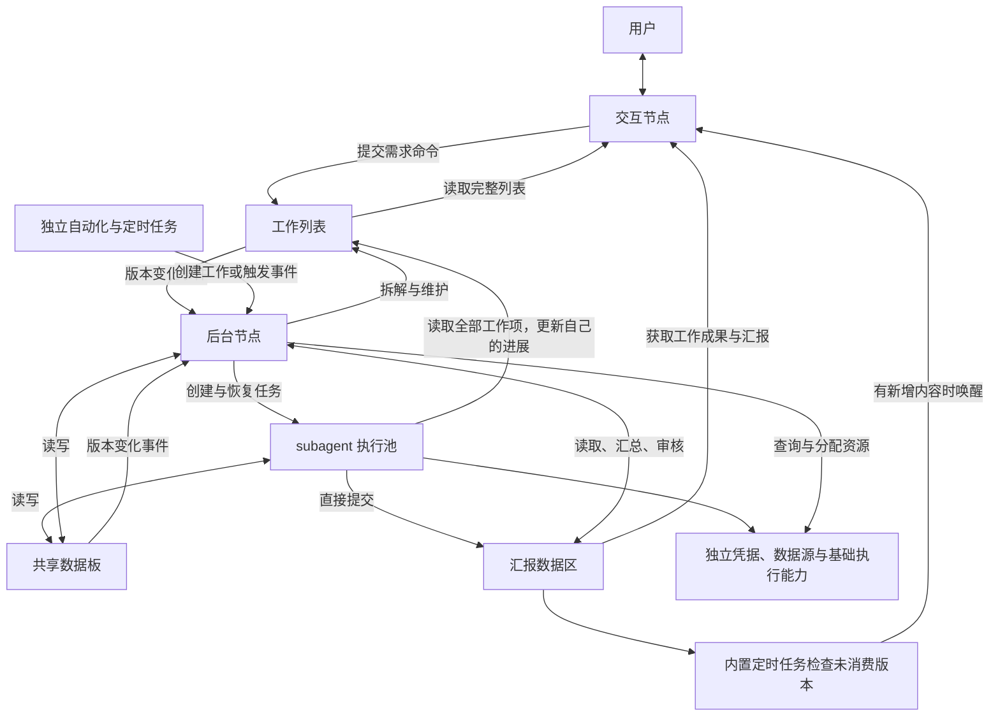

# 超级智能体重构提案

状态：已根据草案接入重构实现。本文保留设计约束；实现范围、验证结果及尚需真实连接验证的项目见 [实现说明](implementation.md)。

## 目标与范围

超级智能体采用一个交互节点、一个后台节点和按任务创建的 subagent。交互节点专门处理用户交互；后台节点专门规划和协调工作；subagent 使用普通智能体的基础执行能力完成任务。

超级智能体应覆盖普通智能体页面的功能，包括会话、附件、工具、Skills、数据源、凭据、自动化、定时任务、项目及产物访问。复用底层实现与界面组件，但超级智能体的凭据库、数据源和自动化具有独立的归属、存储和运行作用域，并支持从普通智能体导入。

“功能齐全”指整个超级智能体系统具备这些能力，不表示交互节点获得所有工具。后台节点能访问所有内部业务数据；凭据依然通过现有安全调用机制使用，不把密钥明文送入模型上下文。

## 已确认边界与建议默认规则

1. 用户先确认设计与需求细化，随后授权“根据草案实现内容”。
2. 用户已确认交互节点也可以读取整个工作列表。交互节点可提交、修订和撤销用户需求；所有节点可查询完整工作列表。后台执行计划、依赖与派工字段由后台节点维护。
3. 交互节点的可读范围为用户消息、交互历史、完整工作列表和汇报区。共享数据板、其他节点执行记录、内部资源库不能直接读取。用户附件由系统登记为引用，内容解析与执行交给后台安排；其结果进入汇报区。以下第 4～7 项为建议默认规则，尚非用户逐项确认的要求。
4. 最大 subagent 数量暂指同时占用执行名额的数量，不包括固定的交互节点和后台节点；历史会话数不受此值限制。
5. subagent 由后台统一创建。暂不开放 subagent 自行派生下级 agent；以后若开放，所有层级也必须计入同一上限。
6. 汇报通知采用用户描述的内置定时任务，检查周期可配置。后台规划由事件触发，定时检查作为漏事件与重启恢复的补偿。
7. 导入暂按一次性复制处理，不自动同步普通智能体后续的修改。模型连接是否也必须独立不在原需求中，暂复用已有连接目录和认证机制。

## 节点与数据流

交互节点不派工、不运行文件或浏览器工具、不调用 MCP 数据源、不读取其他节点历史。它负责理解需求、必要澄清、记录用户约束，以及依据汇报区信息与用户沟通。

后台节点读取全部工作列表、共享数据、汇报、节点状态和自动化配置，负责拆解、依赖、选择模型、分配资源、调整计划、处理失败与核验完成状态。实际任务交给 subagent 执行；后台节点与执行节点的职责分别建模。

subagent 接收明确任务、可用资源和验收条件，能读取整个工作列表、查询共享数据并直接提交汇报。无需通过后台节点转发才能进入汇报区。

## 三个独立的数据区域

| 区域 | 保存内容 | 写入规则 |
| --- | --- | --- |
| 工作列表 | 用户需求、约束、验收条件、计划、依赖、负责人、状态与取消信息 | 交互节点提交需求命令；后台维护计划和分派；subagent 只更新自己的进展或提出变更建议 |
| 共享数据板 | 工作材料、可复用结论、中间结果、问题、产物引用 | 后台和 subagent 按版本读写 |
| 汇报数据区 | 可供交互节点使用的进展、成果、失败、待用户回答的问题和证据 | subagent、后台和宿主直接追加，保留来源和修订关系 |

工作列表应区分用户原始需求和后台拆解的执行项。模型不能在更新执行计划时覆盖用户约束。需求修改生成新版本，保留来源消息；执行结果绑定需求版本，旧版本的晚到结果不能把新需求标记为完成。

建议的工作项状态为 `pending / ready / running / waiting / blocked / submitted / completed / failed / cancelled`。`submitted` 表示已有结果，`completed` 表示满足对应验收条件。汇报区出现一条“完成”文字不能直接改变工作项状态。

汇报记录至少包含：记录 ID、工作项 ID、需求版本、来源节点与运行 ID、类别、正文、证据或产物引用、验证状态、创建时间、递增序号、所替代的旧汇报 ID。类别区分进展、阶段结果、最终结果、失败和待用户输入；验证状态区分未核验、已核验和已失效。

交互节点可直接转述 subagent 的阶段汇报，但应保留其验证状态。最终完成状态由后台结合工作项和验证证据确认，再写入汇报区。产物需要预览时，由界面通过受控附件引用打开；交互节点不会因此获得任意文件读取权限。

所有线程“可看”通过分页查询工具实现，不把整份列表和共享板自动塞入每一轮提示词。默认仅注入当前任务及相关记录的摘要和引用。

## 访问权限必须由宿主强制执行

| 操作 | 交互节点 | 后台节点 | subagent |
| --- | --- | --- | --- |
| 接收用户消息、向用户回复 | 允许 | 通过汇报区 | 通过汇报区 |
| 提交或修订用户需求 | 允许，限定需求字段 | 读取并据此规划 | 提建议 |
| 查询完整工作列表 | 允许 | 允许 | 允许 |
| 修改执行计划、依赖、负责人、验收状态 | 不允许 | 允许 | 仅自己的进展与结果 |
| 读取、写入共享数据板 | 不允许 | 允许 | 允许 |
| 读取汇报区 | 允许 | 允许 | 自己及任务相关汇报 |
| 提交汇报 | 通过用户交互历史记录 | 允许 | 允许直接提交 |
| 创建、恢复、取消 subagent | 不允许 | 允许 | 不允许，暂定 |
| 查询资源配置与凭据元数据 | 不允许 | 允许 | 按任务授权 |
| 读取内部文件、产物与执行记录 | 不允许 | 允许 | 按任务授权 |
| 程序、浏览器、数据源实际操作 | 不允许 | 负责协调与分配 | 按授权执行 |

会话创建时由服务端固定 `scope / role / nodeId / runId`，每次工具调用据此校验；这些身份不能来自模型可填写的参数。隐藏提示词、工具返回值、事件载荷、附件读取和错误详情均遵守同一边界。不能只在提示词里要求交互节点“不看共享板”，同时保留可读取共享板的通用工具。

宿主把执行异常、权限请求和用户需要知道的系统状态写入汇报区，交互节点据此说明情况。普通的配置页面仍允许用户直接管理配置，页面权限与模型工具权限分开。

## 后台调度与 subagent 模型池

设置包含固定交互节点配置、固定后台节点配置、`maxConcurrentSubagents` 和允许使用的模型目录。

创建流程为“主节点 → 后台节点 → subagent 可用模型”。subagent 配置只设置 AI 模型的基本参数、模型能力与评价，不要求用户设置具体 agent 岗位或工作内容。每次启动任务创建独立 subagent 与独立会话；模型条目可被多个任务复用。

每个模型条目包含连接、模型标识、执行后端、描述、用户评价、可选评级、启用状态及模型实际支持的思考强度。模型条目是可选执行资源，不等同于一个永久工作节点。多个 subagent 可以使用同一模型。

后台创建任务时必须显式选择模型条目和 `thinkingLevel`。思考强度由本次调用方决定，用户配置的模型条目不锁定 subagent 的固定思考强度。宿主根据实际模型能力校验；不支持时返回可用选项，让调用方重新选择，避免悄悄修改。恢复同一任务沿用该任务的选择，后续任务不继承上个任务的覆盖值。

并发上限由服务端原子分配名额，不靠提示词约束。准备启动和执行中的任务占用名额；已经停止执行并进入等待或重试延迟的任务可释放名额，恢复时重新排队。取消需等执行进程或调用实际退出后释放名额，不能取消 UI 状态后立即超额启动。

调低上限不强制终止现有任务，暂停新增启动，直至活动数量低于新上限。队列同时遵守任务依赖、文件或浏览器等独占资源、连接并发和模型限速，保留公平调度及失败重试规则。

后台节点自身每次只执行一个规划轮次。运行时新事件合并到待处理集合，当前轮次完成后继续处理，避免多个后台轮次互相覆盖计划。

## 事件与内置定时任务

后台触发源包括工作项变化、共享板变化、subagent 状态变化、汇报变化、自动化触发和等待条件满足。事件持久化并带唯一 ID、作用域、来源、数据版本和关联运行 ID。

数据更新与待发事件必须在同一次可靠提交中保存。使用现有持久化能力时应明确其原子边界；不能先保存状态，再依赖一次内存通知作为唯一触发路径。消费者通过持久游标恢复，允许重复投递但必须幂等。

后台仅处理尚未处理的有效变化。同一批改动合并，自己已纳入本轮规划的写入不再立即触发同一轮工作。无实际内容变化不产生新事件，防止后台写板、写板唤醒后台的空转。

内置汇报定时任务由宿主运行：

1. 检查汇报区最新序号是否超过交互节点已消费的序号；没有变化直接返回，不调用模型。
2. 有新内容时合并为一次交互唤醒，带本批次序号上界；交互节点结合汇报区、完整工作列表和用户对话决定如何回复。
3. 用户消息优先。交互节点忙碌时保存待处理通知，不丢弃新汇报，不并发运行同一个交互会话。
4. 交互节点可选择静默消费普通进度，或向用户发送有价值的新结果、具体问题及失败说明。
5. 回复或静默消费结果持久化后，才推进已消费游标。回复记录使用唯一投递键去重；崩溃恢复不能重复发出同一条交付。
6. 执行期间到达的新汇报留给下一批。用户暂停或停止后不再启动新轮次，重启或恢复时按游标补处理。

具体检查周期、合并窗口和通知频率属于配置项，实施时确定默认值。不得通过固定周期不断发送“检查一下”提示造成空模型调用。

## 独立资源与从普通智能体导入

资源解析统一引入服务端可验证的作用域，例如普通工作区与工作区内的超级智能体实例。数据源目录、缓存键、连接池、凭据标识、自动化锁、运行历史及事件订阅都包含作用域，不能只在界面上分组。

超级智能体的资源可置于 `<workspace>/super-agent/` 下独立目录；凭据继续使用加密凭据后端，并采用独立作用域键，禁止改为明文 JSON。普通智能体资源目录保持原有格式。

导入流程：

1. 用户选择普通智能体的凭据、数据源和自动化；系统展示依赖与同名冲突。
2. 分配新的目标 ID，复制配置并重映射凭据、数据源、脚本及自动化之间的引用。
3. 凭据复制由宿主在安全后端内部完成，不通过模型或前端传递明文。
4. 自动化默认以停用状态导入，显示依赖是否齐全，避免复制完成立即产生重复任务或外部操作。
5. 无法直接复制的认证状态明确要求重新授权。OAuth 令牌的刷新与撤销行为由提供商决定，复制配置不能保证两个独立授权；需要独立授权时重新登录。
6. 导入后修改、删除超级智能体资源不修改普通智能体的本地配置；也不承诺外部账号、原文件或服务端授权会随本地复制而独立。
7. 导入记录保存 ID 映射与失败结果，可安全重试，避免半次导入留下错误引用。

超级智能体自动化的提示动作默认进入工作列表，由后台安排执行。定时任务、事件任务、脚本监控、Webhook、测试、历史和重放均使用独立作用域；不能导入配置后仍由普通智能体的调度器重复执行。

## 页面与基础能力对齐

主界面保留对话和工作列表；提供后台状态、活动 subagent 数量与停止入口。用户能在详情中查看共享板、汇报区、执行记录和产物。用户能查看这些页面，不意味着交互节点能读取其内容。

超级智能体自己的资源入口至少包括凭据库、数据源、自动化和模型池。配置页允许设置两个固定节点、最大 subagent 并发数、模型描述与评价、工作环境和权限。

按普通智能体当前页面逐项建立能力对照表，覆盖：

- 会话历史、流式输出、附件、产物预览和导出。
- API、MCP、本地目录数据源的添加、编辑、认证、检查、启停与删除。
- 凭据添加、管理、受控浏览器填充与程序注入。
- 定时任务、事件自动化、脚本监控、Webhook、测试、历史、重放。
- 内置与自定义工具、Skills、自定义 agent 定义、项目与页面入口。
- 模型连接、执行后端、思考强度、权限审批、运行用量和错误恢复。

各能力需要验证真实执行链路，不能以“页面入口存在”作为完成标准。应用级功能可继续复用，资源归属按本提案边界处理；功能对齐不包含把其他顶层产品模式并入超级智能体。

## 现有实现与替换边界

设计阶段核对的原实现如下（本节记录重构前状态）：

- `packages/shared/src/super-agent/types.ts`：目前以固定 `nodes` 配置每节点模型和思考强度，角色为 `coordinator / orchestrator / worker`。
- `packages/server-core/src/super-agent/SuperAgentService.ts`：已有队列、持久会话、任务、计划与动作处理；意图节点上下文仍直接包含任务产物等数据，需要替换为工作列表与汇报区视图。
- `packages/server-core/src/super-agent/SuperAgentPrompt.ts`：意图节点仍能查询 `collaboration_board`，与新的读取边界冲突。
- `packages/server-core/src/super-agent/SuperAgentResources.ts`：从普通工作区读取数据源，需改为作用域资源解析。
- `packages/server-core/src/sessions/saved-credentials.ts`：保存凭据操作以 `workspaceId` 定位，需接入独立资源作用域。
- `packages/server-core/src/handlers/rpc/automations.ts` 与 `packages/shared/src/automations/resolve-config-path.ts`：自动化配置、锁及历史目前以普通工作区为边界，需要贯穿作用域。
- `apps/electron/src/renderer/components/app-shell/AppShell.tsx`：普通智能体已有数据源、工具、Skills、项目、页面、自动化和凭据入口，可作为功能对照及组件复用来源。

建议保留经过验证的模型会话、工具、凭据安全后端与基础自动化执行器；重写超级智能体的数据模型、角色接口、动态执行池和事件调度。提示词只描述新接口，不能承担权限或调度保证。

旧固定节点配置转换为两个固定节点和保留各模型选择、基本参数及能力标签的允许模型目录。旧岗位名称、岗位描述、工作偏好和技能绑定保留于归档，不作为新模型的名称、能力说明或评价。旧聊天、任务、共享板与运行记录先作为只读历史保存；旧共享板不能直接全部复制进汇报区。迁移期间停掉旧调度器并保存快照，避免新旧系统双重执行；原来结果不明的外部操作先核对，不能在新系统中自动重放。

新入口切换完成后，移除已替代的旧调度路径、工具注册、提示词、预设界面和测试；历史读取适配器可以保留。失败回退必须基于未被新格式覆盖的原始快照。

## 实施顺序与验收

1. 按已确认的交互节点权限固定数据模型与角色工具契约，确定并发上限语义及定时检查默认值。
2. 实现资源作用域与独立存储、工作列表、共享板、汇报区、持久事件和恢复游标。
3. 接入两个固定节点和动态 subagent 执行池，落实并发、模型选择、任务思考强度和取消恢复。
4. 完成定时汇报通知以及后台事件合并；接入独立凭据、数据源、自动化和导入。
5. 重构页面、迁移旧数据、移除旧路径，逐项验证普通智能体基础能力。

关键验收场景：

- 用户发出需求，交互节点落工作项，后台被唤醒并派工，subagent 写汇报，定时任务唤醒交互节点，用户收到结果。
- 交互节点通过共享工具、通用资源接口、隐藏上下文或伪造角色参数均不能读取共享板、执行历史和凭据。
- 后台与任意 subagent 能查询完整工作列表，但不能冒充其他节点修改受限字段。
- 同时触发大量任务时实际运行数不超过上限；两个固定节点仍能工作；下调上限和取消中的任务正确计数。
- 同一模型在不同任务可使用不同受支持思考强度，不产生跨任务继承。
- 汇报通知不丢失、不重复，无变更时零模型调用，重启后从持久游标继续。
- 工作列表与共享板并发更新检测版本冲突；后台不会因自己的无效重复写入无限唤醒。
- 普通智能体与超级智能体同名资源相互隔离；导入正确重映射；停用的导入自动化不运行。
- 用户改需求、取消任务、服务重启、模型失败和晚到结果均不会重复执行已确认的外部操作或错误标记完成。
- 桌面端与执行服务端的 RPC、权限、资源解析及自动化调度采用一致规则，并通过真实数据源与定时任务的端到端检查。
